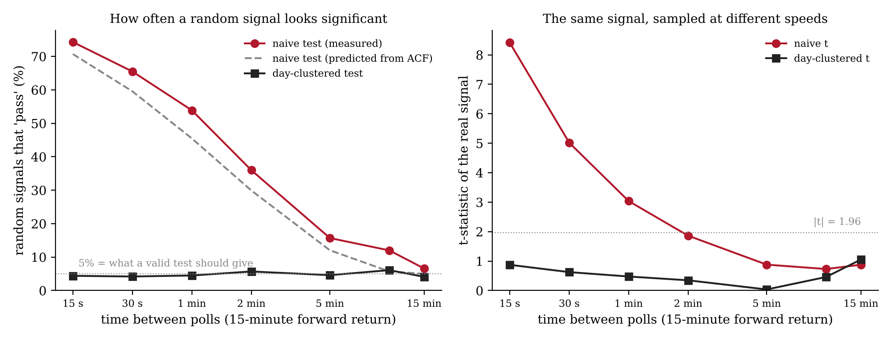

# Extension: how fast can you sample before the t-test lies?

Post-acceptance work. Not in the CSIT 2026 paper. Nothing here changes any number in the paper.

## Question

The paper shows that polling a signal every 15 seconds against 15-minute returns
turns a null into t = 8.41. This asks the general version: for a given forward
horizon, how does the naive test's false-positive rate depend on how often you
sample?

## Method

The real signal, on the same 150 trading days, is thinned to one poll per
interval (15 s, 30 s, 1, 2, 5, 10 and 15 minutes). The 15-minute forward return is
defined exactly as in `analysis/paper_stats.py`. At each interval:

- the naive t and the day-clustered t of the real signal are recomputed;
- 1,000 placebo signals (the paper's within-day circular shift of the real
  signal) are tested, and the share that pass |t| > 1.96 is recorded for both tests;
- a prediction is made from the committed autocorrelation alone. Keeping every
  k-th poll leaves the autocorrelations at lags k, 2k, 3k, ... The naive variance
  is understated by VIF = 1 + 2 x (sum of those autocorrelations), so a signal
  with no predictive power passes with probability 2 x (1 - Phi(1.96 / sqrt(VIF))).

## Result



| Time between polls | Naive t | Day-clustered t | Random signals passing the naive test | Predicted | Passing the clustered test |
|---|---|---|---|---|---|
| 15 s (the engine) | 8.41 | 0.87 | 74.3% | 70.7% | 4.4% |
| 30 s | 5.02 | 0.63 | 65.5% | 59.6% | 4.2% |
| 1 min | 3.04 | 0.48 | 53.9% | 45.5% | 4.5% |
| 2 min | 1.86 | 0.35 | 36.0% | 29.9% | 5.7% |
| 5 min | 0.88 | 0.04 | 15.7% | 12.0% | 4.6% |
| 10 min | 0.73 | 0.46 | 12.0% | 5.7% | 6.1% |
| 15 min | 0.88 | 1.05 | 6.6% | 5.0% | 4.1% |

Sampling the same signal faster made the naive test more confident and more
wrong. At the engine's native speed, three out of four random signals look
significant. The day-clustered test stays near 5% at every speed, which is what a
valid test should do. The prediction from the autocorrelation alone tracks the
measured rate, running a few points low.

The 15-second row reproduces the paper exactly (82,183 observations, t = 8.41
and 0.87). The paper's placebo figure of 77.5% used 200 draws from a different
random seed; 74.3% here uses 1,000 draws.

## Reproduce

```bash
python extensions/sampling_rate_law.py --predict   # no data; checks the committed CSV
python extensions/sampling_rate_law.py --plot      # redraw the figure from the CSV
python extensions/sampling_rate_law.py             # full run, needs the licensed logs
```

Results: `extensions/results/sampling_rate_law.csv`.
